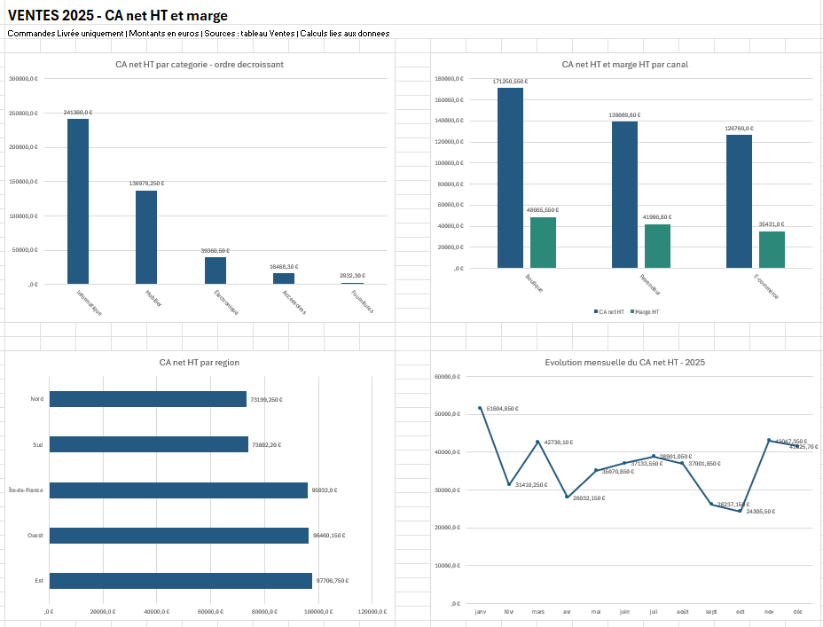
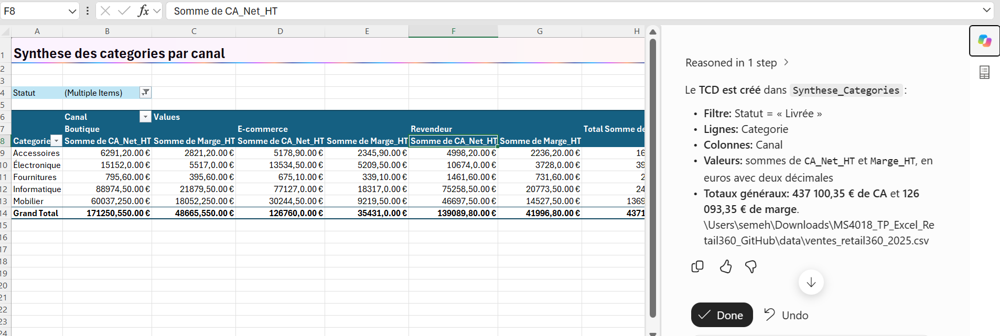
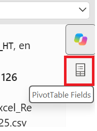
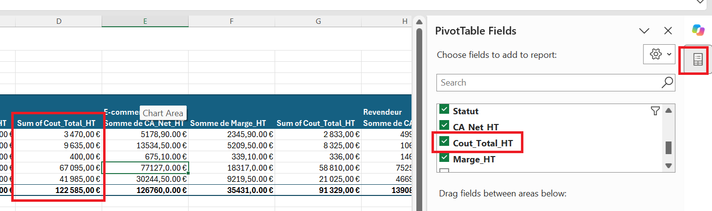
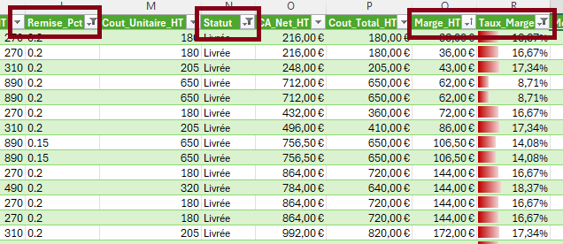

# MS-4018 — TP Copilot dans Excel : Retail360

> **Durée obligatoire : 30 minutes** · Niveau débutant/intermédiaire · Scénario : ventes multicanales de produits divers · Version : 1.0 · Langue : français

## 1. Alignement avec le cahier des charges

L'objectif de cet exercice est d'explorer comment utiliser « Copilot in Excel » pour identifier et expérimenter le potentiel de cet outil dans l'analyse de données.
Les objectifs de cet exercice sont données comme suit: 
1. Questions en langage naturel et génération de colonnes calculées ; 
2. tendances, insights, graphiques et tableaux croisés dynamiques ; 
3. révision des suggestions, surlignage, tri et filtre ; 
4. formule expliquée pas à pas et analyse de bout en bout. 

Le scénario Retail360 est une **proposition créée pour atteindre ces objectifs**.

**Résultat visé :** transformer un export brut de commandes en diagnostic commercial vérifiable, avec des formules, des segments de vente, un graphique et trois recommandations pour la direction.

## 2. Contexte métier et mission

Retail360 est une entreprise fictive qui vend des ordinateurs, écrans, accessoires, mobilier, fournitures et équipements électroniques en France. 
Les commandes proviennent de boutiques, du commerce en ligne et de revendeurs. 

Vous êtes analyste commercial. Votre directrice des ventes demande : « Quel chiffre d'affaires avons-nous réalisé en 2025 ? 
Quels produits, régions et canaux tirent les ventes ? Les remises dégradent-elles nos marges ? Préparez une synthèse factuelle et un graphique. »

**Convention essentielle :** Pour finaliser cet exercice, on se propose d'appliquer certaines conventions données comme suit:
- Seules les commandes `Livrée` contribuent au chiffre d'affaires net et à la marge réalisée ; 
- Les commandes `Annulée` et `Retournée` sont exclues. 
- Le chiffre d'affaires est **HT après remise**, pas le montant brut avant remise. 
- Le coût des produits est pris en compte uniquement sur les unités livrées. 
- Il s'agit de données fictives.

## 3. Fichiers fournis

Pour ce TP, nous utiliserons un jeu de données fictif représentant l'activité commerciale de **Retail360**, une entreprise fictive spécialisée dans la vente de produits divers 
(informatique, électronique, mobilier, accessoires et fournitures de bureau). L'entreprise réalise des ventes dans cinq régions françaises, à travers différents canaux de 
distribution : boutique, e-commerce et revendeurs.

Le fichier principal **`ventes_retail360_2025.csv`** contient **600 commandes réalisées en 2025**, réparties sur 12 produits et 5 catégories. Chaque commande comporte des 
informations telles que la date, le produit, la région, le canal de vente, le commercial, la quantité, le prix unitaire, la remise et le statut de la commande.

L'objectif est d'exploiter ces données avec **Microsoft 365 Copilot dans Excel** pour analyser les performances commerciales, calculer des indicateurs clés (chiffre d'affaires, marge, remises), identifier les tendances et générer des tableaux croisés dynamiques ainsi que des graphiques.
Un second fichier, **`ventes_retail360_2025_qualite.csv`**, est également disponible. Il contient des anomalies volontaires (doublons, valeurs manquantes, remises inhabituelles, etc.) afin de proposer des exercices complémentaires sur la détection et l'amélioration de la qualité des données avec Copilot.

### Dictionnaire de données

Le dataset **Retail360** est composé de 14 colonnes, chacune représentant une information spécifique liée aux commandes commerciales. 
Ces données permettent d'analyser les ventes selon plusieurs dimensions : temporelle, géographique, commerciale et financière.

Le tableau ci-dessous présente la structure du jeu de données, avec le nom des colonnes, leur type, leur signification et un exemple de valeur. 
Ce dictionnaire servira de référence pour comprendre les données, formuler des requêtes pertinentes avec Microsoft 365 Copilot et interpréter correctement 
les résultats des analyses.

| Colonne | Sens | Exemple / remarque |
|---|---|---|
| ID_Commande | Identifiant de commande | CMD-0001 ; unique dans le fichier principal |
| Date_Commande | Date de la vente | 2025-01-15 ; convertir en date Excel |
| ID_Produit | Référence | P001 à P012 |
| Produit | Libellé commercial | Écran 27 pouces |
| Categorie | Famille de produits | Informatique, Accessoires, Mobilier, Électronique, Fournitures |
| Region | Zone géographique | Nord, Sud, Est, Ouest, Île-de-France |
| Canal | Origine commerciale | Boutique, E-commerce, Revendeur |
| Commercial | Responsable | Six commerciaux fictifs |
| Type_Client | Segment de clientèle | Entreprise, Particulier, Administration |
| Quantite | Nombre d'unités | Entier |
| Prix_Unitaire_HT | Prix HT avant remise | EUR par unité |
| Remise_Pct | Taux de remise | 0,05 = 5 % |
| Cout_Unitaire_HT | Coût unitaire HT | EUR par unité |
| Statut | État de commande | Livrée, Retournée, Annulée |

### Pré-requis technique avant la session)

1. Vérifier que chaque participant dispose d'une licence **Microsoft 365 Copilot éligible à Copilot dans Excel**, d'une version d'Excel compatible et d'un accès OneDrive ou SharePoint selon la configuration de l'organisation.
2. Déposer le CSV principal dans un espace partagé et préparer un classeur Excel `.xlsx` enregistré dans OneDrive/SharePoint si l'environnement l'exige. Éviter de rester sur le CSV : les formules, graphiques et tableaux doivent être conservés dans le `.xlsx`.
3. Dans Excel, importer via **Données > À partir d'un fichier texte/CSV** ; vérifier le délimiteur point-virgule, la conversion des dates et des nombres, puis **Charger**. Adapter les paramètres régionaux d'import si nécessaire.
4. Cliquer dans la plage, **Insertion > Tableau**, cocher « Mon tableau comporte des en-têtes » et nommer le tableau `Ventes` dans l'onglet **Création de tableau**.
5. Enregistrer sous `Retail360_Analyse_Copilot.xlsx`. Vérifier que le bouton Copilot est accessible et que le tableau est reconnu. Les fonctions, boutons et capacités exacts varient selon le canal, la licence et la version d'Excel ; préparer un plan B manuel.

## 4. Guide pas à pas : parcours principal

### Étape 1 — Ouvrir et comprendre le tableau

**Manipulations :** ouvrir le fichier `.xlsx` préparé ; vérifier les 600 commandes et 14 champs initiaux ; sélectionner une cellule du tableau `Ventes` ; repérer les colonnes `Statut`, `Quantite`, `Prix_Unitaire_HT`, `Remise_Pct` et `Cout_Unitaire_HT` ; ouvrir le volet Copilot. Montrer comment retrouver la source utilisée dans la réponse.

**Question d'amorce :** « Que représente une ligne ? Peut-on additionner toutes les commandes pour calculer les ventes réalisées ? » Réponse: non, il faut exclure les statuts non livrés.

### Étape 2 — Poser des questions métier en langage naturel

**Prompt 1 — Reconnaissance du fichier**

```text
Tu es analyste des ventes. Analyse uniquement le tableau Excel nommé Ventes.
Décris en 5 points : le nombre de lignes, la période couverte, les catégories,
les canaux de vente et les valeurs distinctes du champ Statut.
Ne suppose aucune information absente du tableau. Signale les limites.
```

**Prompt 2 — Cadrage du KPI**

```text
Dans Ventes, explique pourquoi le chiffre d'affaires réalisé ne doit pas
inclure les commandes Annulée et Retournée. Identifie précisément les colonnes
nécessaires pour calculer chiffre d'affaires HT net, coût et marge.
Présente la réponse sous forme de tableau : indicateur, colonnes, règle.
```

**Prompt 3 — Les top produits et catégories**

```text
Identifie les 5 produits ayant généré le plus de chiffre d'affaires net HT, en considérant uniquement les commandes livrées et en appliquant les remises.
Présente les catégories les plus représentées avec leur nombre de commandes. Détecte les valeurs manquantes et indique les colonnes concernées.
Vérifie le nombre total de commandes, leur répartition par statut (Livrée, Retournée, Annulée) et confirme que toutes les dates appartiennent à 2025.
Présente les résultats dans des tableaux chiffrés et explique brièvement les calculs effectués. Ne modifie pas les données sources.
```

### Étape 3 — Construire des formules et les expliquer

**Prompt 4 — Calcul du chiffre d'affaire net HT**

```text
Dans le tableau Ventes, ajoute une nouvelle colonne nommée `CA_Net_HT` qui calcule le chiffre d'affaires net hors taxes de chaque commande, en tenant compte des quantités vendues, des prix unitaires et des remises appliquées.
Seules les commandes dont le statut est **« Livrée »** doivent générer du chiffre d'affaires. 
Pour les autres statuts, la valeur doit être égale à zéro.
Génère la formule Excel adaptée et explique brièvement son fonctionnement avant de l'appliquer.
```

**Prompt 5 — Proposition de formules**

```text
Dans le tableau Ventes du fichier excel, ajoute les colonnes calculées suivantes au tableau en utilisant les forules associées:
1. CA_Net_HT : Quantite × Prix_Unitaire_HT × (1 − Remise_Pct),
   uniquement si Statut = "Livrée", sinon 0.
2. Cout_Total_HT : Quantite × Cout_Unitaire_HT si Livrée, sinon 0.
3. Marge_HT : CA_Net_HT − Cout_Total_HT.
4. Taux_Marge : Marge_HT / CA_Net_HT si CA_Net_HT > 0, sinon 0.
```

**Prompt 6 — Changer le format des colonnes**

```text
Dans le tableau Ventes, applique les formats suivants :
CA_Net_HT, Cout_Total_HT et Marge_HT : format monétaire en euros (€), avec deux décimales.
Taux_Marge : format pourcentage (%), avec deux décimales.
Conserve les valeurs et les formules existantes sans les modifier.
```

**Manipulations :** 
- Lire les formules proposées ; 
- Vérifier les conditions sur `Statut` ; 
- Accepter les suggestions si elles sont correctes ; 
- Sinon créer les quatre colonnes à droite du tableau et saisir les formules ;
- Formater `CA_Net_HT`, `Cout_Total_HT`, `Marge_HT` en devise EUR et `Taux_Marge` en pourcentage. 
- Contrôler une ligne `Livrée` et une ligne `Annulée`.

**Prompt 7 — Calculer le total des remises appliquées**

```text
Dans le tableau Ventes, ajoute une nouvelle colonne nommée `Montant_Remise_HT` permettant de calculer le montant total de la remise accordée pour chaque commande, en tenant compte de la quantité, du prix unitaire HT et du taux de remise.
Génère la formule Excel correspondante, explique brièvement son fonctionnement et applique-la à toutes les lignes du tableau.
```

### Étape 4 — Analyser la performance (13:00–18:00)

**Prompt 8 — Diagnostic chiffré**

```text
À partir du tableau Ventes et des colonnes calculées, considère uniquement
les ventes Livrée. Calcule le chiffre d'affaires HT net, la marge HT et le
taux de marge sur CA global (somme des marges / somme des CA).
Présente ensuite les 5 catégories classées par CA, les 3 canaux et les
5 régions. Pour chaque segment : CA, marge, taux de marge sur CA.
Précise les critères de calcul et ne mélange pas moyenne des taux et taux global.
```

Ce prompt permet de montrer comment Copilot dans Excel peut réaliser une analyse commerciale multidimensionnelle à partir des données de ventes. 
Il aide à calculer les indicateurs clés de performance (chiffre d'affaires, marge et taux de marge), à comparer les résultats par catégorie, 
canal de distribution et région, et à identifier les segments les plus performants.

**Prompt 9 — Générer un visuel**

```text
À partir des résultats de l'analyse des ventes du tableau Ventes, crée les graphiques suivants :
1. Histogramme : chiffre d'affaires net HT par catégorie de produits, classé par ordre décroissant.
2. Graphique en colonnes : comparaison du chiffre d'affaires net HT et de la marge HT par canal de distribution.
3. Graphique en barres : chiffre d'affaires net HT par région.
4. Graphique en courbes : évolution mensuelle du chiffre d'affaires net HT sur l'année 2025.

Utilise uniquement les commandes dont le statut est « Livrée ». 
Ajoute des titres explicites, affiche les montants en euros et insère les graphiques dans une nouvelle feuille nommée `Dashboard_Ventes`, 
si cette action est disponible.
```



*Figure 1 — Générer des visuels de l'analyse avec des prompts Copilot.*

**Prompt 10 — Générer un rapport complet des tendances et anomalies**

```text
À partir du tableau Ventes, réalise une analyse des performances commerciales de Retail360 pour l'année 2025, en considérant uniquement les commandes dont le statut est « Livrée ».
1. Identifie les 5 produits les plus performants en chiffre d'affaires net HT et les 5 plus rentables en marge HT.
2. Repère les régions dont le taux de marge est inférieur au taux global** de l'entreprise.
3. Analyse les remises accordées par canal de distribution** et leur relation avec la rentabilité.
4. Compare le chiffre d'affaires par type de client.
5. Identifie 3 tendances ou anomalies significatives et propose des pistes d'amélioration.
Présente les résultats dans des tableaux chiffrés, avec les classements et les indicateurs utilisés. Termine par une synthèse de **3 recommandations commerciales**, en distinguant les faits observés des hypothèses à vérifier.
```

### Étape 5 — Tableau croisé dynamique et graphique (18:00–23:00)

**Prompt 11 — TCD**

```text
Propose un tableau croisé dynamique à partir de Ventes, filtré sur Statut = Livrée.
Lignes : Categorie. Colonnes : Canal. Valeurs : somme de CA_Net_HT et somme
de Marge_HT. Créer le TCD dans une nouvelle feuille du fichier Excel nommée Synthese_Categories, après confirmation.
```


*Figure 2 — Générer un TCD avec des prompts Copilot.*

1- Cliquer sur **Done** pour valider la création de votre TCD et le rajouter à la nouvelle feuille sous excel.
2- Cliqer à droite sur le bouton **PivotTable Fields** comme indiqué ci-dessous:


*Figure 3 — Passer en mode edition de votre TCD sur la feuille Excel.* 

3- Sélectionner le champs Cout_Total_HT pour l'ajouter à votre TCD


*Figure 4 — Ajouter le champs Cout_Total_HT à votre TCD.*
 
### Étape 6 — Filtrer, trier, surligner, améliorer (23:00–27:00)

**Prompt 12 — Repérage des ventes à surveiller**

```text
Dans Ventes, identifie les commandes Livrée dont Remise_Pct
est supérieure ou égale à 0.15 et dont Taux_Marge est inférieur à 20%.
Propose un filtre, un tri par Marge_HT croissante et une mise en forme
conditionnelle pour ajouter des barres en rouge à la colonne Taux de marge.
```

**Manipulations :** 
- Filtrer `Statut = Livrée`, `Remise_Pct >= 0.15`, `Taux_Marge < 20 %` ; 
- Trier `Marge_HT` croissante ; 
- Surligner la colonne `Taux_Marge` avec une règle `Inférieur à 0,20` ; 
- Contrôler que la règle s'applique à la plage attendue ; 
- Vérifier que vous avez les barres en rouge dans la colonne Taux_Marge.


*Figure 5 — Ajouter un filtre et une mise en forme conditionnell aux colonnes du tableau.*

**Prompt 13 — Restauration des résultats**

```text
Copie le résultat de l'analyse précédente dans une nouvelle feuille nommée `Analyse_Remises_Risque`, 
en conservant les données, le tri et la mise en forme conditionnelle.
Ensuite, restaure la feuille principale `Ventes` dans son état initial, en supprimant les filtres, 
les tris et les mises en forme ajoutés lors de l'analyse, sans modifier les données ni les formules d'origine.
```

### Étape 7 — Vérification et restitution

**Prompt 14 — synthèse pour la direction**

```text
Rédige une synthèse de direction de 120 mots maximum fondée uniquement sur
le tableau Ventes. Donne 3 constats chiffrés vérifiables, 2 points de vigilance
et 3 actions commerciales concrètes. Pour chaque chiffre, précise le filtre
Statut = Livrée et la mesure utilisée. N'invente ni causalité ni prévision.
```

**Débrief :** 
- Un analyste montre un KPI, un graphique et un filtre ; 
- Le groupe vérifie un résultat à l'aide d'Excel. Poser les questions : « Qu'a calculé Copilot ? », « Qu'avons-nous vérifié ? », « Quelle décision serait prématurée ? ».

## 6. Résultats de contrôle (fichier principal uniquement)

**Prompt 15 — Validation des résultats obtenus**

```text
Rédige une synthèse de direction de 120 mots maximum fondée uniquement sur
le tableau Ventes. Donne 3 constats chiffrés vérifiables, 2 points de vigilance
et 3 actions commerciales concrètes. Pour chaque chiffre, précise le filtre
Statut = Livrée et la mesure utilisée. N'invente ni causalité ni prévision.
```

Ces chiffres proviennent du CSV principal généré avec une graine fixe, et permettent de contrôler la cohérence des manipulations et vérifier l'exactitude des résultats retournés par Copilot :

| Mesure | Valeur attendue |
|---|---:|
| Nombre total de commandes | 600 |
| Nombre de commandes `Livrée` | 505 |
| CA HT net réalisé | **437 100,35 €** |
| Marge HT réalisée | **126 093,35 €** |
| Taux de marge sur CA global | **28,85 %** (arrondi) |

Le nombre de commandes non livrées est 95. 
**Attention :** un calcul qui additionne tous les statuts ou utilise le prix avant remise ne correspond pas à ces résultats. Les résultats peuvent différer si un participant travaille sur la variante « qualité », modifie les filtres ou importe incorrectement les décimales.

## 7. Banque de manipulations supplémentaires (hors des 30 minutes)

### A. Exploration et compréhension

1. Analyse le tableau Ventes et crée un dictionnaire des données indiquant pour chaque colonne son nom, son type présumé (texte, nombre, date, pourcentage) et sa signification métier. Présente le résultat dans un tableau.
2. Vérifie les types de données du tableau Ventes. Identifie les colonnes numériques ou les dates qui sont enregistrées au format texte. Indique les problèmes détectés et propose les corrections nécessaires sans modifier les données.
3. Analyse le tableau Ventes et recherche les valeurs vides, les identifiants de commande en doublon et les quantités nulles. Présente les anomalies détectées avec les numéros de lignes concernés.
4. Compte les commandes par statut et par région dans le tableau Ventes. Présente les résultats dans un tableau croisé dynamique et ajoute un graphique permettant de comparer les régions.
5. Compare le nombre de commandes livrées et le nombre total d'unités vendues pour chaque catégorie de produits. Présente les résultats dans un tableau et explique brièvement les différences entre ces deux indicateurs.
6. Identifie les 10 commandes livrées ayant le chiffre d'affaires net HT le plus élevé. Affiche leur identifiant, leur produit, leur région, leur quantité et leur montant. Classe les résultats par ordre décroissant.
7. Calcule le panier moyen des commandes livrées en divisant le chiffre d'affaires net HT total par le nombre de commandes livrées. Compare ensuite ce panier moyen par canal de distribution et présente les résultats dans un tableau.
8. Pour les commandes livrées, calcule la remise moyenne simple et la remise moyenne pondérée par le montant brut HT des commandes. Compare les deux résultats, explique leur différence et présente les calculs utilisés.
9. Dans le tableau Ventes, ajoute une colonne Trimestre qui détermine automatiquement le trimestre de chaque commande à partir de Date_Commande. Utiliser le format suivant: T1-Année pour reoprésenter l'année associé à chaque trimestre.

### B. Formules et calculs

9. Créer `Montant_Brut_HT = Quantite * Prix_Unitaire_HT`.
10. Créer `Montant_Remise_HT = Montant_Brut_HT * Remise_Pct`.
11. Créer `CA_Net_HT` avec condition sur `Statut`.
12. Créer `Cout_Total_HT` avec condition sur `Statut`.
13. Créer `Marge_HT` et expliquer le signe négatif éventuel.
14. Créer `Taux_Marge_sur_CA` et le formater en %.
15. Créer `Annee = ANNEE([@Date_Commande])`.
16. Créer `Mois_Num = MOIS([@Date_Commande])` pour un tri chronologique fiable.
17. Créer `Mois = TEXTE([@Date_Commande];"mmmm")` et expliquer pourquoi le tri alphabétique est incorrect.
18. Créer `Trimestre = "T"&(ENT((MOIS([@Date_Commande])-1)/3)+1)` ; vérifier les parenthèses si Copilot propose une formule invalide.
19. Créer `Alerte_Remise = SI([@Remise_Pct]>=0,15;"Remise forte";"Standard")`.
20. Créer `Alerte_Marge = SI(ET([@Statut]="Livrée";[@Taux_Marge]<0,2);"À surveiller";"OK")`.
21. Comparer `SOMME.SI.ENS` et TCD pour obtenir le CA par canal.
22. Demander une explication cellule par cellule d'une formule structurée.
23. Corriger une formule proposée qui inclut les commandes retournées.
24. Comparer marge en euros, taux de marge sur CA et marge sur coût.

### C. Analyses commerciales

25. Top 5 produits par CA.
26. Top 5 produits par marge absolue.
27. Top 5 produits par unités vendues.
28. Catégorie la plus rentable en taux de marge sur CA.
29. Classement des régions par CA et par marge.
30. Performance des canaux Boutique / E-commerce / Revendeur.
31. Comparaison des segments Entreprise / Particulier / Administration.
32. CA et marge par commercial, sans conclure sur leur performance individuelle sans contexte.
33. Évolution mensuelle du CA, de la marge et du panier moyen.
34. Comparaison premier et second semestre.
35. Comparaison des trimestres et contribution au total annuel.
36. Analyse des remises par catégorie et par canal.
37. Nombre et valeur brute des commandes annulées/retournées, sans les assimiler à des ventes réalisées.
38. Sensibilité : simuler une réduction de remise de 2 points sur les ventes livrées, **sans** prétendre prévoir la demande.
39. Contribution cumulée des produits au CA (analyse Pareto).
40. Identifier les combinaisons catégorie/canal à faible marge.

### D. Visualisations et interactions Excel

41. TCD CA par catégorie et canal.
42. TCD marge par région et type de client.
43. TCD CA par mois et catégorie.
44. Graphique en colonnes des catégories.
45. Courbe mensuelle du CA.
46. Barres horizontales des dix meilleurs produits.
47. Graphique combiné CA + taux de marge (vérifier l'axe secondaire).
48. Segments `Region`, `Canal` et `Categorie` sur un TCD.
49. Chronologie sur `Date_Commande` si dates correctement reconnues.
50. Mise en forme conditionnelle des faibles marges.
51. Mise en évidence des remises élevées.
52. Tri multicritère région puis CA décroissant.
53. Filtrage des seules commandes livrées et e-commerce.
54. Dupliquer un graphique puis changer son axe pour illustrer les risques de mauvaise lecture.

### E. Esprit critique et gouvernance

55. Demander à Copilot de citer les colonnes à l'origine de chaque KPI.
56. Lui faire expliquer pourquoi `MOYENNE(Taux_Marge)` n'est pas le taux global.
57. Lui demander d'identifier les hypothèses non prouvées dans une synthèse.
58. Comparer un prompt vague et un prompt cadré (objectif, contexte, source, format).
59. Demander une proposition de modification **sans l'appliquer**, puis la relire.
60. Recalculer manuellement un échantillon de trois commandes.
61. Vérifier l'impact d'un filtre oublié sur le résultat.
62. Tester l'atelier qualité : doublon, remise 85 %, région `nord`, quantité 0, produit vide.
63. Demander un plan de nettoyage **non destructif** de la variante qualité.
64. Construire une synthèse distinguant observations, hypothèses et recommandations.

## 8. Prompts supplémentaires pour une analyse commerciale

### Prompt « Pareto produits »

```text
Sur les seules commandes Livrée de Ventes, classe les produits par CA_Net_HT
décroissant. Calcule leur part du CA total et leur part cumulée. Identifie
combien de produits représentent environ 80 % du CA. Explique les limites
d'une interprétation commerciale fondée uniquement sur le CA.
```

### Prompt « Analyse des remises »

```text
Pour chaque Canal, compare CA_Net_HT, Marge_HT, taux de marge sur CA et remise
moyenne sur les commandes Livrée. Indique clairement si la remise moyenne
est simple ou pondérée. N'affirme pas que les remises causent la baisse de marge.
```

### Prompt « Contrôle qualité »

```text
Analyse la variante de données qualité sans la modifier. Recherche :
identifiants de commande dupliqués, régions incohérentes, produits vides,
quantités nulles et remises supérieures à 50 %. Propose un tableau des
anomalies avec colonne, problème, impact métier et correction à valider.
```

### Prompt « Direction commerciale »

```text
Agis comme contrôleur de gestion. Rédige un rapport factuel de 150 mots
maximum avec : CA HT net réalisé, marge HT, taux de marge sur CA, catégorie
leader, canal leader, une anomalie à surveiller et trois actions. Chaque
affirmation chiffrée doit pouvoir être vérifiée dans le tableau Ventes.
```

### Prompt « Contre-expertise »

```text
Audite ta dernière réponse. Identifie les chiffres non sourcés, les erreurs
potentielles de filtres, les confusions entre montant brut et net, les moyennes
incorrectes et les conclusions causales non démontrées. Propose une version
corrigée et explique les vérifications que je dois faire dans Excel.
```

## 9. Critères de réussite et grille d'évaluation

**Objectif de l'évaluation**

Cette évaluation vise à mesurer la capacité des participants à exploiter efficacement Microsoft 365 Copilot dans Excel, tout en adoptant une démarche critique face aux résultats générés par l'intelligence artificielle.

L'évaluation porte sur trois dimensions essentielles : la justesse des calculs, la pertinence des analyses produites et la capacité à vérifier et interpréter les résultats.

**Grille d'évaluation**

| Critère d'évaluation | Points | Indicateur de réussite |
|---|---:|---|
| Compréhension des données | 1 | Copilot identifie correctement la structure du tableau Ventes, les colonnes et les types de données. |
| Fiabilité des formules générées | 2 | Les formules sont correctes, les remises sont prises en compte et les commandes non livrées sont exclues des indicateurs réalisés. |
| Exactitude des indicateurs clés (KPI) | 2 | Le nombre de commandes, le CA net HT, la marge HT et le taux de marge global correspondent aux valeurs de référence. |
| Pertinence des analyses commerciales | 1.5 | Les classements et comparaisons par produit, catégorie, région et canal reposent sur les bons indicateurs. |
| Qualité des visualisations | 1 | Les graphiques et tableaux croisés dynamiques sont cohérents avec les données, lisibles et correctement présentés. |
| Interprétation des résultats | 1 | Les conclusions sont pertinentes, justifiées par des données chiffrées et distinguent les observations des hypothèses. |
| Vérification critique des réponses | 1.5 | Les résultats sont contrôlés avec Excel, les incohérences sont identifiées et les corrections nécessaires sont apportées. |
| **Total** | **10** | Réussite conseillée : 7/10 |

## 11. Dépannage rapide

Cette section présente les **problèmes les plus fréquemment rencontrés lors de l'utilisation de Microsoft 365 Copilot dans Excel**, ainsi que les vérifications et solutions permettant de les résoudre rapidement.

Le tableau ci-dessous sert de **guide de dépannage** pour le formateur et les participants. 
Il permet d'identifier l'origine d'un dysfonctionnement, qu'il soit lié à la configuration de Copilot, au format des données ou aux fonctionnalités d'Excel, afin de poursuivre le TP sans perdre de temps. 
Lorsque Copilot ne peut pas réaliser une action, une manipulation manuelle dans Excel peut être utilisée comme solution alternative.

| Symptôme | Vérification / solution |
|---|---|
| Copilot indisponible | Licence, application/version compatible, connexion, politique administrateur et emplacement du classeur ; utiliser le plan B manuel |
| Copilot ne reconnaît pas les données | Vérifier que la plage est un tableau structuré nommé `Ventes`, avec en-têtes uniques et sans cellules fusionnées |
| Les prix sont du texte | Réimporter le CSV en sélectionnant les paramètres régionaux adaptés au point décimal |
| Les dates sont du texte | Convertir `Date_Commande` en véritable date avant regroupement par mois |
| Formule refusée | Vérifier langue Excel, séparateurs `;` ou `,`, noms de fonctions et accents dans les valeurs de statut |
| TCD compte au lieu de sommer | Vérifier que `CA_Net_HT` est numérique ; choisir **Somme** dans les paramètres du champ |
| Résultat incohérent | Contrôler filtres, statut, remise et distinction entre somme des ratios et ratio des sommes |
| Copilot ne crée pas de TCD/graphique | Demander la procédure et exécuter l'insertion via le ruban Excel ; les capacités varient selon le déploiement |