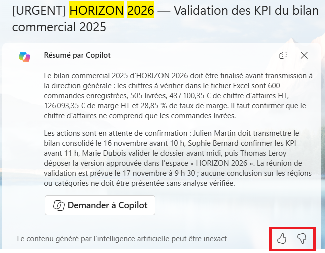
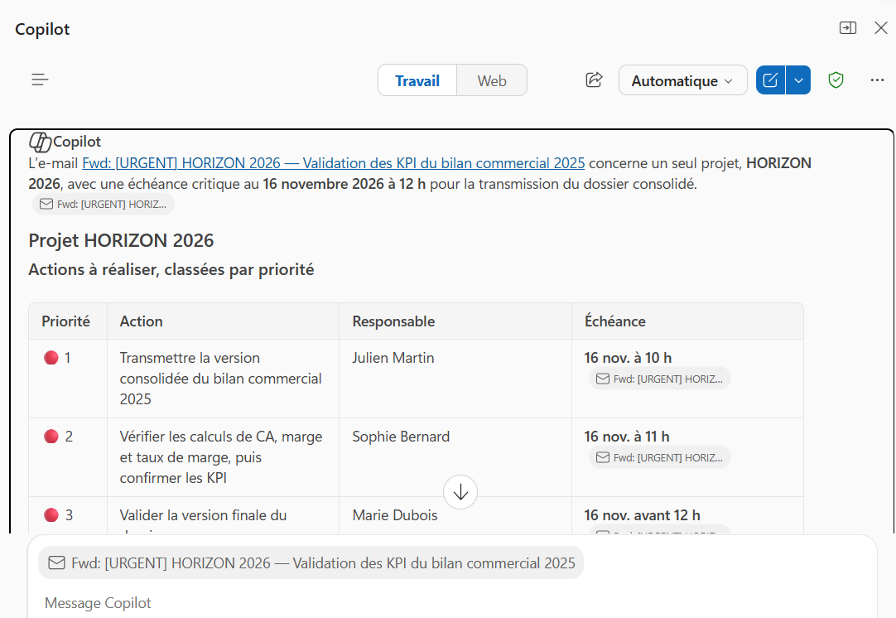

# TP MS-4018 — Utiliser Microsoft 365 Copilot dans Outlook

**Cas fil rouge : Retail360 — Bilan commercial 2025 et préparation 2026**  
**Durée : 30 minutes** · **Niveau : débutant / intermédiaire**

## 1. Contexte et mission

Après l'analyse des ventes dans Excel et la préparation d'une présentation PowerPoint, vous devez gérer les échanges liés au bilan commercial 2025 de Retail360. 
Votre mission : comprendre rapidement un fil d'e-mails, répondre aux interlocuteurs, améliorer vos messages et organiser la suite du travail.

**Données de référence (commandes livrées uniquement)** : 600 commandes enregistrées, 505 livrées, chiffre d'affaires net HT **437 100,35 €**, marge HT **126 093,35 €**, taux de marge global **28,85 %**. 
Les 95 commandes non livrées ne sont pas comptabilisées dans le CA réalisé. 
Ne pas inventer de classements par région, produit ou canal.

## 2. Objectifs pédagogiques

- Résumer une conversation et identifier les décisions, questions et actions en attente.
- Rédiger un nouvel e-mail avec Copilot.
- Répondre à un message à partir du contexte de la conversation.
- Réécrire un brouillon et ajuster son ton et sa longueur.
- Utiliser le coaching de Copilot pour améliorer la qualité du message.
- Préparer un échange de suivi et, si disponible, exploiter Copilot pour planifier une réunion.
- Contrôler les faits, les destinataires et les pièces jointes avant envoi.

## 3. Prérequis et préparation du formateur

- Compte Microsoft 365 disposant des fonctionnalités Copilot dans une version compatible d'Outlook ; les commandes et leurs emplacements peuvent varier selon le client, la licence et le déploiement.
- Boîte de test ou de démonstration : **ne pas envoyer de messages à des contacts réels** pendant le TP.
- Préparer un fil d'e-mails fictifs « Retail360 — Bilan 2025 et priorités 2026 » (voir annexe) ; le formateur peut envoyer les messages entre comptes de test ou les importer dans une boîte de démonstration.
- Prévoir un destinataire de test pour les brouillons et réponses. Le formateur précise si l'envoi est autorisé ; sinon, **enregistrer les brouillons sans envoyer**.
- Copilot doit pouvoir accéder au fil dans Outlook ; éviter les boîtes partagées ou scénarios non pris en charge.

## Préparation du TP — Mise en place des e-mails Retail360 dans Outlook

Avant de commencer les exercices, nous avons préparé un environnement de travail simulant les échanges professionnels de l'entreprise fictive **Retail360**.

### 1. Création des e-mails fictifs

Cinq e-mails ont été rédigés pour représenter différentes situations professionnelles : 
- Validation urgente d'un bilan commercial, 
- Analyse des commandes non livrées, 
- Etude des performances commerciales, 
- Préparation d'un comité de direction et lancement d'un projet de reporting.

Chaque message contient des informations exploitables par Copilot :

- Un **nom de projet** et son contexte.
- Des **intervenants** avec leurs rôles et responsabilités.
- Des **actions et livrables attendus**.
- Des **échéances précises** et différents niveaux d'urgence.
- Des informations permettant d'identifier les priorités et les décisions en attente.

### 2. Enregistrement et envoi des messages

Les cinq e-mails ont été enregistrés, puis envoyés vers le **compte Outlook de formation disposant de Microsoft 365 Copilot**.
Les messages ont été préparés avec des objets distincts, des expéditeurs identifiés et des destinataires principaux ou en copie, afin de reproduire des échanges professionnels réalistes.

### 3. Vérification de l'environnement

Avant de démarrer le TP :

1. Ouvrir Outlook avec le compte Microsoft 365 sur lequel Copilot est activé.
2. Vérifier la réception des cinq e-mails Retail360.
3. Contrôler les objets, les contenus et les informations des messages.
4. Vérifier que les fonctionnalités Copilot sont accessibles dans Outlook.
5. Conserver les messages dans la boîte de réception ou dans un dossier dédié **« TP Retail360 »**.

### 4. Objectif de cette préparation

Cette mise en situation permet aux participants de travailler sur des **e-mails réellement présents dans leur boîte Outlook**, plutôt que sur des exemples théoriques.

Ils pourront ensuite utiliser Copilot pour résumer les échanges, rechercher des informations, identifier les intervenants, extraire les échéances, hiérarchiser les urgences, rédiger des réponses et préparer des réunions.

**Résultat attendu :** un environnement Outlook contenant cinq messages Retail360 prêts à être exploités dans les exercices pratiques avec Microsoft 365 Copilot.

## 4. Déroulé guidé

### Étape 1 — Résumer un fil d'e-mails

**Objectif.** Extraire rapidement les informations essentielles d'une conversation sans relire tous les messages.

**Manipulations dans Outlook**

1. Ouvrez la boîte de réception et recherchez le projet **« HORIZON 2026 »** dans la barre de recherche.
2. Ouvrez la conversation contenant plusieurs messages.
3. Activez **Résumer avec Copilot** (ou l'action équivalente proposée dans le volet Copilot) comme indiqué dans la figure suivante:


*Figure 1 — Rechercher et investiger les email par nom de projet.*

4. Remarquer qu'une fois lemail sélectionné, copilot récupèr directement le contexte dans le prompt.
5. Lisez le résumé et comparez-le aux messages d'origine.



*Figure 2 — Résumer un mail avec Copilot.*

6. Relevez les actions à réaliser, les personnes concernées et les questions encore ouvertes en utilisant le prompt suivant:

**Prompt 01:**

```text
Analyse cet e-mails Retail360 reçus dans Outlook.
Présente sous forme de tableau :
- Les actions à réaliser et leurs échéances.
- Les personnes concernées et leurs responsabilités.
- Les questions encore ouvertes ou les décisions en attente.
Regroupe les informations par projet et classe les actions par ordre de priorité. N'invente aucune information absente des e-mails.
```



*Figure 3 — Résultat des tâches à faire extraites avec Copilot.*

**Prompt 02 :**

```text
Résume cet échange Retail360 en distinguant les informations confirmées,
les questions ouvertes et les actions à réaliser. N'invente aucune décision.
```

**Résultat attendu.** Un résumé fidèle, distinguant les KPI validés des analyses et décisions encore à préparer.

### Étape 2 — Prioriser les e-mails après un retour de congé

Après une période d'absence, utilisez Copilot dans Outlook pour identifier rapidement les messages importants reçus pendant vos congés. 
Cette étape permet de repérer les urgences, les échéances, les demandes nécessitant une réponse et les actions en attente, afin de prioriser 
le traitement de votre boîte de réception.

**Prompt 03 :**

```text
Je viens de rentrer de congé. Analyse les e-mails reçus pendant la dernière semaine.
Identifie les messages les plus importants et classe-les par priorité : urgente, haute, normale ou faible.
Présente un tableau avec l'expéditeur, l'objet, le projet concerné, l'action attendue et l'échéance.
Signale les délais dépassés et propose un ordre de traitement pour organiser ma boîte de réception.
N'invente aucune information absente des messages.
```

**Résultat attendu** : une liste priorisée des e-mails reçus pendant l'absence, accompagnée d'un plan d'action permettant de reprendre efficacement son activité.

### Étape 3 — Analyser le caledrier outlook avec Copilot

Pour poursuivre le TP Microsoft 365 Copilot dans Outlook, voici 10 réunions fictives à créer dans le calendrier du compte de formation.
Elles reprennent les projets et les intervenants des cinq e-mails Retail360 précédemment préparés. 

L'objectif est de disposer d'un calendrier suffisamment riche pour tester les fonctionnalités de Copilot : recherche de réunions, préparation d'agendas, identification des participants, détection des conflits et organisation des priorités.
Les dates sont proposées à partir du 16 novembre 2026. Les réunions sont fictives et leur planification ne signifie pas que les décisions évoquées ont été validées.

**Prompt 04 :**

```text
Analyse mes réunions Retail360 à venir. 
Présente un tableau avec les dates, les projets, les participants, les objectifs et les actions à préparer.
```
**Prompt 05 :**

```text
Identifie ma prochaine réunion Retail360 et prépare une fiche de briefing : contexte, ordre du jour, 
participants, documents nécessaires et questions à poser.
```
**Prompt 06 :**

```text
Classe mes réunions Retail360 par importance en tenant compte des échéances, des projets et des décisions attendues. 
Justifie brièvement les priorités.
```
**Prompt 07 :**

```text
Retrouve toutes mes réunions liées au projet LIVRAISON+. 
Résume leurs objectifs, les participants et les livrables attendus.
```

**Prompt 08 :**

```text
Compare les dates de mes réunions Retail360 avec les échéances indiquées dans mes e-mails. 
Signale les réunions trop tardives, les dépendances et les points à clarifier.
```

**Prompt 09 :**

```text
À partir de mon calendrier et de mes e-mails Retail360, prépare un planning de travail pour la semaine du 16 novembre 2026 en tenant 
compte des réunions et des livrables prioritaires.
```


### Étape 4 — Rédiger un nouvel e-mail avec Copilot

**Objectif.** Créer rapidement un message professionnel à partir d'une consigne.

**Manipulations dans Outlook**

1. Cliquez sur **Nouveau courrier/message**.
2. Ouvrez **Brouillon avec Copilot** / **Rédiger avec Copilot** (intitulé variable selon la version).
3. Saisissez le prompt ci-dessous, puis lancez la génération.

**Prompt 10 :**

```text
Dans le cadre du projet LIVRAISON+, analyse l'historique de mes e-mails Outlook pour identifier les personnes les plus pertinentes à contacter 
concernant les 95 commandes non livrées en 2025. Propose les destinataires principaux.
Rédige ensuite un e-mail professionnel leur demandant de partager les réclamations, commentaires et retours clients, afin d'identifier les 
causes des annulations et retours et de proposer des actions correctives.
Demande une réponse avant le 18 novembre 2026 à 12 h.
```

4. Examinez la proposition et utilisez les options de régénération ou d'ajustement si disponibles.
5. Insérez le texte dans le brouillon ; vérifiez l'objet et le destinataire de test.
6. Demander à Copilot de rajouter directement les destinataires dans les champs nécessaires du mail. Vérifier que cette action ne peut
   pas être réalisée car les emails ne sont pas ajoutés à l'annuaire. 

**Résultat attendu.** Un message avec objet pertinent, introduction, données fiables et demande d'action explicite.

Après avoir rédigé l'e-mail de demande de retours clients, utilisez Copilot dans Outlook pour organiser le suivi des réponses attendues. 
Cette étape permet d'anticiper les relances, de suivre les informations manquantes et de préparer les prochaines actions du projet LIVRAISON+.

**Prompt 11 :**

```text
À partir des échanges Outlook concernant le projet LIVRAISON+, prépare un plan de suivi des retours clients sur les 95 commandes non livrées.
Identifie les personnes sollicitées, les informations attendues et les échéances.
Présente un tableau indiquant les réponses déjà reçues, les éléments manquants et les personnes à relancer.
Propose un message de relance professionnel pour les interlocuteurs n'ayant pas répondu.
Ne considère pas un brouillon comme un e-mail envoyé et ne crée aucune réponse fictive. N'envoie aucun message sans ma validation.
```

**Résultat attendu.**
À l'issue de ce prompt, Copilot doit permettre de :
- Identifier les interlocuteurs concernés par le projet LIVRAISON+ et préciser leurs responsabilités.
- Générer un tableau de suivi présentant les informations attendues, les échéances, les réponses reçues et les actions restantes.
- Détecter les réponses manquantes et distinguer les messages envoyés des messages effectivement distribués.
- Repérer les erreurs de distribution, notamment les adresses e-mail invalides d'Emma Laurent et Lucas Petit.
- Identifier les actions prioritaires, comme vérifier les adresses des destinataires avant toute relance.
- Proposer des messages de relance professionnels et adaptés au contexte, sans les envoyer automatiquement.
- Distinguer les faits confirmés des informations manquantes, sans inventer de retours clients ni de causes aux commandes non livrées.

### Étape 5 — Transformer un e-mail en réunion de suivi avec Copilot

**Objectif.** Dans la continuité du projet LIVRAISON+, proposez aux participants d'utiliser Copilot pour préparer une réunion de coordination 
à partir des échanges Outlook. 

L'objectif est de réunir les interlocuteurs concernés afin de résoudre les problèmes de distribution des e-mails, 
récupérer les retours clients manquants et organiser les prochaines actions.

Utiliser le prompt suivant pour cette manipulation:

**Prompt 12 **

```text
Analyse les échanges Outlook concernant le projet LIVRAISON+ et les 95 commandes non livrées en 2025.
Je souhaite organiser une réunion de suivi de 30 minutes pour faire le point sur les retours clients et les informations manquantes.
À partir de l'historique des e-mails :
1. Identifie les personnes pertinentes à inviter et explique brièvement leur rôle.
2. Propose un titre clair pour la réunion.
3. Prépare un ordre du jour structuré avec une durée pour chaque sujet.
4. Identifie les questions à résoudre, notamment les erreurs de distribution, les réponses manquantes et les causes des commandes non livrées restant à investiguer.
5. Consulte les disponibilités des participants dans Outlook, si elles sont accessibles, et propose trois créneaux de 30 minutes.
Prépare les informations nécessaires à la création de l'invitation Outlook, sans envoyer d'invitation sans ma validation. N'invente ni disponibilité ni information manquante.
```

**Résultats attendus**
- Une liste pertinente de participants, justifiée par les échanges Outlook.
- Un ordre du jour adapté au projet LIVRAISON+.
- Une synthèse des problèmes à résoudre et des décisions à préparer.
- Un créneau compatible avec les disponibilités accessibles.
- Une invitation Outlook complète, vérifiée avant envoi.

L'objectif est de laisser Copilot analyser les échanges Outlook et déterminer lui-même les caractéristiques de la réunion, sans lui imposer 
de titre, de participants, de date ou d'ordre du jour.

**Prompt 13 **

```text
Analyse l'historique de mes e-mails Outlook concernant le projet LIVRAISON+.
À partir des échanges, des demandes formulées, des échéances et des actions en attente, détermine si une réunion de suivi est nécessaire.
Si c'est le cas, organise et crée directement cette réunion dans mon calendrier Outlook en déterminant toi-même :
- Le titre et l'objectif de la réunion.
- Les participants pertinents et leurs adresses e-mail.
- La durée appropriée.
- La date et l'horaire, en tenant compte des échéances et des disponibilités accessibles.
- Le format de la réunion (Teams ou présentiel).
- L'ordre du jour, les points à clarifier et les décisions attendues.
Appuie-toi exclusivement sur les informations disponibles dans mes e-mails et mon calendrier. Vérifie notamment les éventuelles erreurs 
de distribution avant de sélectionner les destinataires.
Crée l'événement dans mon calendrier Outlook, puis présente-moi un récapitulatif de ses informations.
Demande ma validation avant d'envoyer les invitations aux participants. Si une information indispensable manque ou si tu ne peux pas 
effectuer la création directement, signale-le sans inventer de données.
```
## 6. Dépannage et limites

- **Copilot n'apparaît pas** : vérifier la licence, le compte connecté, le client Outlook pris en charge et la disponibilité de la fonctionnalité ; prévoir une démonstration formateur.
- **Résumé absent** : utiliser un fil comportant plusieurs messages ; la fonction dépend du client et de la disponibilité de Copilot.
- **Coaching indisponible** : utiliser le prompt alternatif de réécriture.
- **Copilot ne crée pas la réunion** : générer le texte de l'invitation puis créer l'événement manuellement dans le calendrier.
- **Informations inexactes ou manquantes** : retourner aux e-mails sources et aux chiffres Excel ; ne pas considérer la sortie Copilot comme une preuve.
- **Confidentialité** : utiliser uniquement des données fictives et des destinataires de test.