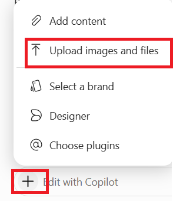
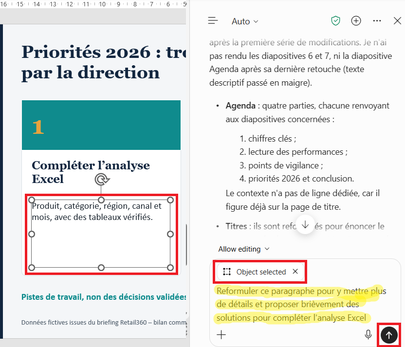

# TP MS-4018 — Créer et optimiser une présentation avec Copilot dans PowerPoint

> **Module :** Copilot dans PowerPoint
> **Durée imposée :** 15 minutes
> **Niveau :** débutant à intermédiaire  
> **Cas fil rouge :** Retail360 — bilan commercial 2025 et priorités 2026  
> **Livrable :** `Retail360_Bilan_Commercial_2025.pptx` (5 à 6 diapositives, avec notes)

## 1. Contexte et mission

Vous êtes responsable commercial de **Retail360**, une entreprise fictive qui vend des produits informatiques, électroniques, du mobilier, des accessoires et des fournitures. Vous venez de terminer une analyse des ventes 2025 dans Excel. La direction attend une présentation concise pour une réunion de pilotage : résultats clés, lecture des performances, risques et trois actions prioritaires pour 2026.

**Mission :** utiliser Microsoft 365 Copilot dans PowerPoint pour créer un premier support, l'améliorer, le réorganiser et le contrôler. L'enjeu n'est pas seulement de produire des diapositives : il faut conserver des chiffres exacts, des messages compréhensibles et des recommandations distinguant faits et hypothèses.

## 2. Objectifs pédagogiques

À l'issue du TP, le participant doit pouvoir :

1. Créer une présentation depuis une instruction ou un document Word de référence.
2. Obtenir un plan de diapositives adapté à un public de direction.
3. Ajouter ou retravailler une diapositive, son titre et son contenu.
4. Demander des notes du présentateur et une diapositive d'agenda.
5. Ajuster la mise en page et intégrer des visuels pertinents.
6. Résumer une présentation, en modifier l'ordre et vérifier les affirmations.
7. Identifier ce qui doit être effectué manuellement lorsque Copilot ne réalise pas une action.

## 3. Fichiers fournis et données de référence

Le TP s'appuie sur le cas Retail360 déjà utilisé dans Excel. Un document Word de briefing est fourni : `Brief_Retail360_Bilan_2025.docx`. 
Il contient le contexte, les chiffres validés et les consignes de restitution. Il peut servir de source pour la génération de diapositives. 
Une variante consiste à copier son contenu dans le prompt ou dans une présentation vierge.

### 3.1 Indicateurs validés

| Indicateur | Valeur de référence |
|---|---:|
| Commandes enregistrées en 2025 | 600 |
| Commandes livrées | 505 |
| Chiffre d'affaires net HT réalisé | 437 100,35 € |
| Marge HT réalisée | 126 093,35 € |
| Taux de marge sur CA global | 28,85 % (arrondi) |

**Règle métier :** les indicateurs de chiffre d'affaires et de marge réalisés portent uniquement sur les commandes au statut `Livrée`. Le taux global est le rapport *somme des marges / somme des CA*, et non la moyenne simple des taux par commande.

**Important :** aucune répartition chiffrée par produit, catégorie, région, canal ou mois n'est fournie dans le briefing. Copilot ne doit **pas inventer** de classement ni de tendance. Si vous disposez des résultats du TP Excel, vous pouvez les ajouter au document source après vérification.

### 3.2 Pré-requis et vérification

- Vérifier la licence et l'accès à Copilot dans PowerPoint.
- Placer le document Word dans un emplacement OneDrive/SharePoint autorisé, si nécessaire.
- Préparer une présentation vierge et, si possible, un thème d'entreprise (couleurs, polices, logo fictif facultatif).
- Vérifier que les fonctionnalités « créer depuis un fichier », « modifier une diapositive » et « notes du présentateur » sont disponibles ; prévoir les variantes manuelles ci-dessous.
- Ne pas promettre une insertion automatique d'images, de graphiques ou de notes : la disponibilité dépend de l'application, de la licence et du déploiement.

## 4. Guide des fonctionnalités et de l'interface

Le TP combine **Copilot dans PowerPoint** et les **outils natifs de PowerPoint**. 
Les noms des commandes peuvent varier selon PowerPoint pour Windows, Mac ou le Web, ainsi que selon la licence et le déploiement. 
Les participants testent les commandes dans son environnement avant la session.

| Fonctionnalité à explorer | Où agir | Ce que fait le participant | Nature |
|---|---|---|---|
| Volet Copilot | Bouton **Copilot** du ruban ou volet latéral | Ouvrir la conversation, saisir une demande, relancer et affiner | Copilot |
| Créer une présentation | Option de création avec Copilot, lorsqu'elle est proposée | Définir objectif, audience, longueur et source | Copilot |
| Créer depuis un document | Option **Créer à partir d'un fichier**, lorsqu'elle est proposée | Sélectionner le briefing Word accessible et contrôler les diapositives obtenues | Copilot, selon disponibilité |
| Ajouter une diapositive | Copilot ou **Accueil > Nouvelle diapositive** | Ajouter une diapositive de décisions, puis vérifier son emplacement | Copilot / natif |
| Réécrire une sélection | Sélectionner une zone de texte, puis utiliser Copilot si proposé | Raccourcir, reformuler, adapter le ton | Copilot, selon disponibilité |
| Synthétiser la présentation | Volet Copilot | Obtenir les messages clés et repérer les répétitions | Copilot |
| Générer des notes | Volet Copilot, puis volet **Notes** | Demander des notes orales, contrôler et insérer le résultat | Copilot / natif |
| Visuels et images | Copilot si option proposée ; **Insertion > Images / Icônes** | Ajouter un visuel pertinent et vérifier sa qualité | Copilot / natif |
| Suggestions de disposition | **Création > Concepteur / Suggestions de conception**, si disponible | Tester une disposition, puis comparer avant/après | Natif, éventuellement assisté |
| Thèmes et dispositions | **Création**, **Accueil > Disposition** | Appliquer une identité visuelle cohérente | Natif |
| Réorganisation | Volet des miniatures ou **Affichage > Trieuse de diapositives** | Déplacer et supprimer des diapositives | Natif ; Copilot peut conseiller |
| Accessibilité | **Révision > Vérifier l'accessibilité** (emplacement variable) | Contrôler contraste, ordre de lecture et texte alternatif | Natif |
| Présentation orale | **Diaporama**, mode Présentateur ; **Répéter avec le coach** si disponible | Tester le rythme, les notes et la durée | Natif |
| Export et diffusion | **Fichier > Exporter / Partager** | Enregistrer en PPTX ou exporter en PDF | Natif |

**Règle de démonstration :** Vérifier si les modifications ont été effectuées réellement et sont visibles sur la diapositive. 
Lorsque Copilot fournit seulement des conseils ou du texte, appliquer les changements dans PowerPoint.

## 5. Déroulé de l'exercice

### Étape 1 — Générer une première présentation à partir d'un fichier wrod. 

**Parcours guidé dans l'interface :**

1. Ouvrir PowerPoint et vérifier le compte Microsoft 365 connecté.
2. Ouvrir une présentation vierge, choisir un thème dans **Création**, puis enregistrer le fichier sur un emplacement autorisé.
3. Cliquer sur **Copilot** pour ouvrir le volet conversationnel ; repérer la zone de saisie et les suggestions disponibles.
4. Désigner `Brief_Retail360_Bilan_2025.docx` comme source, ou coller le contenu pertinent du briefing dans la demande.



*Figure 1 — Ajouter le fichier word des détails à Copilot.*

5. Utiliser le prompt suivant pour créer la première version de votre présentation

**Prompt 1 — Cadrer et générer la présentation**

```text
Tu es responsable commercial chez Retail360. Tu dois préparer un bilan 2025 pour
pour le comité de direction de Retail360 à partir du fichier briefing en pièce jointe, à présenter en 5 minutes. 
Propose un plan de 5 à 6 diapositives contenant: contexte, KPI, lecture des performances, points de vigilance, priorités 2026
et conclusion. Appuie-toi uniquement sur le document de briefing fourni en pièce jointe.
Ne crée pas de chiffres manquants.
```

**À vérifier dans le résultat généré :** 
- Le plan est-il adapté à une direction ? 
- Les titres expriment-ils une idée et non seulement un thème ? 
- Les informations manquantes sont-elles signalées ?

### Étape 2 — Améliorer le fond et la forme

Après avoir généré une première version de la présentation avec Microsoft 365 Copilot, il est important de vérifier la cohérence de sa structure et la pertinence des titres proposés. 
Copilot peut parfois omettre certaines diapositives, comme l'agenda, ou générer des titres trop génériques. 

Cette étape permet aux participants d'utiliser Copilot pour améliorer une présentation existante, en ajoutant une diapositive d'agenda, 
en reformulant les titres pour mieux refléter le contexte commercial de Retail360 et en garantissant un enchaînement logique des informations.

**Prompt 2 — Ajouter un agenda et améliorer les titres des diapositives**

```text
Analyse la présentation actuelle consacrée au bilan commercial 2025 de Retail360 et améliore sa structure.

1. Ajoute une diapositive « Agenda » après la page de titre, présentant les principales parties de la présentation.
2. Reformule les titres des diapositives pour qu'ils soient plus professionnels, explicites et adaptés au contexte commercial, en évitant les titres trop génériques.
3. Vérifie que l'ordre des diapositives suit une progression logique : contexte, résultats commerciaux, analyse des performances, recommandations et conclusion.
4. Assure-toi que l'agenda correspond au contenu réel de la présentation.

Conserve les données chiffrées, les graphiques et les informations existantes. Ne crée pas de nouveaux résultats commerciaux.
```

**Parcours guidé dans l'interface :**

1. Sélectionner la diapositive des KPI (ou toute autre diapositive) et identifier un bloc de texte trop dense.
2. Sélectionner le texte et utiliser l'option de réécriture Copilot **si proposée** ; sinon demander une reformulation dans le volet puis remplacer manuellement le texte.



*Figure 2 — Reformuler un texte existant dans la slide avec Copilot.*

3. On utilisera le prompt suivant pour transformer la slide qui contient les KPIs en une image plus modernes et professionnelle. On commence par sélectionner la slide  puis dans copilot ajouter le prompt suivant:

**Prompt 3 — Simplifier une diapositive**

```text
À partir de la diapositive actuelle présentant les indicateurs clés de performance (KPI) de Retail360 pour 2025, 
transforme son contenu en une infographie moderne et professionnelle.
Génère une image au format 16:9 intégrant tous les KPI existants, avec leurs valeurs exactes, sous forme de cartes 
visuelles accompagnées d'icônes adaptées (commandes, chiffre d'affaires, marge et rentabilité).
Utilise un design épuré, des couleurs harmonieuses, une typographie lisible et une hiérarchie visuelle mettant 
en évidence les chiffres importants.
Insère directement l'image générée dans la diapositive actuelle, en remplacement de la présentation visuelle existante, 
sans créer de nouvelle diapositive.
Conserve exactement les données chiffrées et les intitulés des indicateurs, sans inventer ni modifier aucune information.
```


*Figure 3 — Transformer les cartes utilisées pour les KPIs en une image professionnelle.*

4. Demander à Copilot des notes du présentateur ; afficher **Notes** et vérifier qu'elles sont présentes, sinon les coller. Utiliser le prompt suivant:

**Prompt 4 — Ajouter les notes du présentateur aux slides**

```text
Génère des notes du présentateur pour chaque diapositive de la présentation Retail360 — Bilan commercial 2025.
Rédige un discours professionnel et synthétique (environ 1 minute par diapositive), en expliquant les points clés et en ajoutant des transitions.
Insère directement les notes dans chaque diapositive, sans modifier leur contenu ni inventer d'informations.
```

5. Utilise le prompt suivant pour simplifier une diapositive de la présentation

**Prompt 5 — Simplifier une diapositive**

```text
Améliore la diapositive des performances 2025 : conserve exactement le contenu
de la slide, reformule le texte, mets en valeur les valeurs numériques et la marge et propose
une mise en page lisible avec des blocs KPI. Ne modifie aucun chiffre.
```

**Point d'observation :** Copilot peut proposer un contenu ou un design sans pouvoir appliquer automatiquement chaque changement. 
Faire constater la différence aux utilisateurs.

**Manipulations :** sélectionner une diapositive trop dense, demander une reformulation, améliorer sa disposition, puis ajouter des notes orales. 
Si Copilot propose un contenu à appliquer, le relire avant validation.

### Étape 3 — Réorganiser et synthétiser

**Parcours guidé dans l'interface :**

Après avoir enrichi la présentation, utilisez Copilot pour optimiser l'enchaînement des diapositives et rendre le discours plus cohérent. 
Demandez-lui de réorganiser les slides selon une progression logique et de mettre à jour l'agenda pour refléter la nouvelle structure. 
Vérifiez ensuite le résultat dans le mode Trieuse de diapositives de PowerPoint.

1. Utiliser le prompt suivant pour réorganiser les slide:

**Prompt 6 — Réorganiser les diapositives avec Copilot**

```text
Réorganise les diapositives de la présentation Retail360 — Bilan commercial 2025 pour améliorer la logique et la fluidité du discours.
Modifie directement l'ordre des diapositives en suivant une progression cohérente : contexte, KPI, analyses, recommandations et conclusion.
Mets à jour automatiquement la diapositive Agenda pour refléter le nouvel ordre, sans modifier les données ni supprimer de contenu.
```

### Étape 4 — Contrôler et enregistrer

Pour rendre la présentation plus orientée vers l'action, utilisez Copilot pour ajouter une diapositive « Décisions attendues ». 
Cette étape permet de transformer les résultats commerciaux de Retail360 en propositions concrètes à soumettre à la direction, 
sans les présenter comme des décisions déjà validées.

**Prompt 7 — Ajouter une diapositive de décision**

```text
Ajoute une diapositive « Décisions attendues » avec trois décisions possibles :
valider les indicateurs, approfondir les segments commerciaux et définir
les priorités 2026. Présente-les comme des propositions, pas des décisions prises.
```

Utilisez Copilot pour uniformiser la police et la taille des textes sur l'ensemble des diapositives. 
Cette étape permet d'améliorer la lisibilité, de renforcer la cohérence visuelle et d'appliquer une mise en forme professionnelle 
à la présentation Retail360, sans modifier son contenu.

**Prompt 8 — Harmoniser la typographie de la présentation**

```text
Applique directement à toutes les diapositives de la présentation Retail360 les règles de mise en forme suivantes :
- Police : Aptos
- Titres : 30 pt, en gras
- Sous-titres : 22 pt
- Texte principal : 18 pt
- Notes et légendes : 14 pt
Harmonise la typographie sur l'ensemble de la présentation, sans modifier le contenu, les chiffres ni l'ordre des diapositives.
Applique les modifications directement, sans créer de nouvelles diapositives.
```

Utilisez Copilot pour harmoniser l'identité visuelle de la présentation Retail360 en appliquant une charte graphique cohérente. 
Cette étape permet d'uniformiser les couleurs, les arrière-plans, les titres et les alignements afin d'obtenir une présentation professionnelle, 
tout en préservant les données et les indicateurs commerciaux.

**Prompt 8 — Harmoniser la typographie de la présentation**

```text
Applique directement une **charte graphique cohérente** à toutes les diapositives de la présentation Retail360.
Utilise un style moderne et professionnel avec :
- Couleurs : bleu foncé, turquoise et fond clair.
- Titres : courts, lisibles et homogènes.
- Mise en page : alignements réguliers, espacements équilibrés et visuels harmonisés.

Conserve tous les contenus et chiffres existants. Applique les modifications directement aux diapositives, sans en créer de nouvelles.
```

Utilisez Copilot pour moderniser la présentation des trois priorités 2026 de Retail360. 
Cette étape permet de transformer une diapositive riche en texte en une feuille de route visuelle, plus synthétique et facile 
à présenter à la direction, tout en conservant les informations essentielles.

**Prompt 9 — Améliorer le design de la diapositive « Priorités 2026 » avec Copilot**

```text
Améliore directement le design de la diapositive « Priorités 2026 ».
Transforme les trois étapes existantes en une feuille de route visuelle, avec des icônes, des textes 
plus courts et une progression claire entre les étapes.
Conserve les trois priorités, leur ordre et leur sens. 
Utilise la charte graphique bleu foncé et turquoise de Retail360.
Applique les modifications à la diapositive actuelle, sans en créer une nouvelle ni inventer d'informations. 
Présente ces priorités comme des pistes de travail, et non comme des décisions validées.
```

### 6. Variantes de prompts très courts pour explorer les fonctionnalités

| Besoin | Prompt à tester |
|---|---|
| Ajouter une diapositive | « Ajoute une diapositive Décisions attendues avec trois propositions à valider. » |
| Raccourcir un texte | « Réduis le texte sélectionné à trois puces de dix mots maximum. » |
| Adapter le ton | « Reformule cette diapositive pour un comité de direction. » |
| Améliorer le titre | « Propose un titre qui exprime le message principal de cette diapositive. » |
| Ajouter des notes | « Prépare 30 secondes de notes orales pour cette diapositive. » |
| Proposer un visuel | « Suggère une représentation visuelle simple des trois priorités 2026. » |
| Résumer le support | « Résume la présentation en trois messages clés, sans ajouter de faits. » |
| Détecter les répétitions | « Repère les diapositives redondantes et propose un nouvel ordre. » |
| Préparer les questions | « Propose cinq questions possibles de la direction et signale celles sans réponse. » |
| Vérifier les affirmations | « Repère les chiffres et conclusions non justifiés par le briefing. » |

---

## 7. Dépannage rapide

| Symptôme | Vérification / solution |
|---|---|
| Copilot absent | Vérifier licence, application, compte connecté et politique administrateur |
| Word non proposé comme source | Vérifier accès au fichier, emplacement cloud et fonction disponible ; utiliser le texte du briefing dans le prompt |
| Présentation trop longue | Demander 5 à 6 diapositives maximum ; supprimer manuellement les doublons |
| Chiffres incorrects | Corriger depuis le tableau de référence ; ne pas demander à Copilot de les estimer |
| Notes non créées | Demander le texte des notes puis le coller dans le volet Notes |
| Mise en page non appliquée | Utiliser le thème, les dispositions et les outils de conception de PowerPoint |
| Graphique non pertinent | Ne créer de graphique de série que si les données correspondantes existent |
| Images non cohérentes | Préférer icônes simples ou visuels de marque, vérifier les droits et la pertinence |
| Action non disponible dans Copilot | Demander une procédure détaillée puis effectuer l'action dans le ruban PowerPoint |